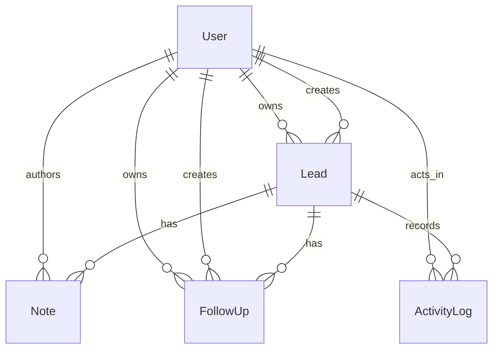

# Domain Model

Entities:

- `User`
  Schema/model: `prisma/schema.prisma` — `model User`
  Primary service owner: `src/services/authService.ts` — `authenticateUser()` for login and `src/services/dashboardService.ts` — `getAssignableUsersForViewer()` for assignment visibility
- `Lead`
  Schema/model: `prisma/schema.prisma` — `model Lead`
  Primary service owner: `src/services/leadService.ts` — `createLeadRecord()`, `getLeadDetail()`, and `updateLeadRecord()`
- `Note`
  Schema/model: `prisma/schema.prisma` — `model Note`
  Primary service owner: `src/services/noteService.ts` — `addLeadNote()`
- `FollowUp`
  Schema/model: `prisma/schema.prisma` — `model FollowUp`
  Primary service owner: `src/services/followUpService.ts` — `addLeadFollowUp()` and `changeFollowUpStatus()`
- `ActivityLog`
  Schema/model: `prisma/schema.prisma` — `model ActivityLog`
  Primary service owner: `src/services/leadService.ts`, `src/services/noteService.ts`, and `src/services/followUpService.ts` through `createActivityLog()`

Important relationships to notice:

- `Lead.ownerId` and `Lead.createdById` are separate in `prisma/schema.prisma`, which lets the system distinguish who currently owns pipeline execution from who originally entered the lead.
- `FollowUp.ownerId` is separate from `FollowUp.createdById`, and `src/services/followUpService.ts` enforces reassignment rules before those fields can diverge.
- `Lead.nextFollowUpAt` is denormalized on the parent lead in `prisma/schema.prisma`, and `src/services/followUpService.ts` updates it through `syncLeadNextFollowUp()` after follow-up changes so the dashboard query in `src/repositories/leadRepository.ts` stays cheap.
- `ActivityLog.metadata` in `prisma/schema.prisma` is JSON because stage changes, reassignment events, and follow-up events do not all need the same payload shape.

