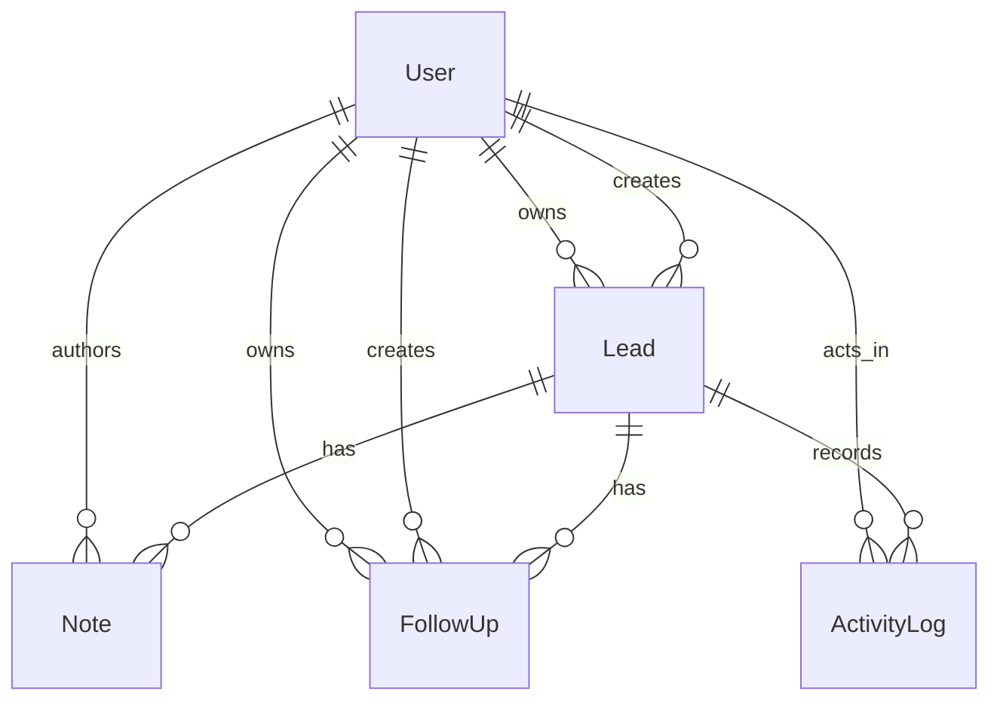
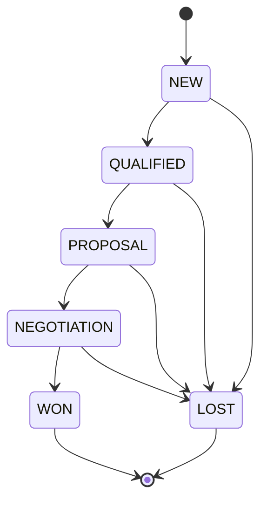

# Domain Model



Entities:

- `User`
  Schema/model: `prisma/schema.prisma` — `model User`
  Primary service owner: `src/services/authService.ts` — `authenticateUser()` for login and `src/services/dashboardService.ts` — `getAssignableUsersForViewer()` for assignment visibility
- `Lead`
  Schema/model: `prisma/schema.prisma` — `model Lead`
  Primary service owner: `src/services/leadService.ts` — `createLeadRecord()`, `getLeadDetail()`, and `updateLeadRecord()`
- `Note`
  Schema/model: `prisma/schema.prisma` — `model Note`
  Primary service owner: `src/services/noteService.ts` — `addLeadNote()`
- `FollowUp`
  Schema/model: `prisma/schema.prisma` — `model FollowUp`
  Primary service owner: `src/services/followUpService.ts` — `addLeadFollowUp()` and `changeFollowUpStatus()`
- `ActivityLog`
  Schema/model: `prisma/schema.prisma` — `model ActivityLog`
  Primary service owner: `src/services/leadService.ts`, `src/services/noteService.ts`, and `src/services/followUpService.ts` through `createActivityLog()`

Important relationships to notice:

- `Lead.ownerId` and `Lead.createdById` are separate in `prisma/schema.prisma`, which lets the system distinguish who currently owns pipeline execution from who originally entered the lead.
- `FollowUp.ownerId` is separate from `FollowUp.createdById`, and `src/services/followUpService.ts` enforces reassignment rules before those fields can diverge.
- `Lead.nextFollowUpAt` is denormalized on the parent lead in `prisma/schema.prisma`, and `src/services/followUpService.ts` updates it through `syncLeadNextFollowUp()` after follow-up changes so the dashboard query in `src/repositories/leadRepository.ts` stays cheap.
- `ActivityLog.metadata` in `prisma/schema.prisma` is JSON because stage changes, reassignment events, and follow-up events do not all need the same payload shape.

**Clarification (FollowUp owner):** the reassignment rule in `followUpService.ts:45-47` stops a rep from assigning a follow-up to someone else. It does not tie `FollowUp.ownerId` to `Lead.ownerId`. A manager can assign a follow-up on any lead to any active user, and a lead can later be reassigned while its follow-ups keep their old owner. So `FollowUp.ownerId` and `Lead.ownerId` can and do diverge. See finding A4 in [`auth-and-permissions.md`](auth-and-permissions.md).

## Fields, model by model

All line numbers are in `prisma/schema.prisma`.

### User (lines 57-72)

| Field | Type | Notes |
| --- | --- | --- |
| `id` | `String @id @default(cuid())` | also the `sub`-like `id` inside the session JWT |
| `email` | `String @unique` | login key; `loginSchema` lowercases it before lookup (`authSchemas.ts:11`) |
| `name` | `String` | used in activity messages such as "Riley moved the lead..." |
| `role` | `UserRole` | `ADMIN`, `MANAGER`, `REP` (lines 10-14) |
| `passwordHash` | `String` | bcrypt; never leaves `authService.ts` (it returns a 4-field `SessionUser`, lines 30-35) |
| `isActive` | `Boolean @default(true)` | checked at login and when assigning owners; not checked per request |
| `createdAt`, `updatedAt` | `DateTime` | standard |

Six back-relations (lines 66-71) name the two User-to-Lead and two User-to-FollowUp relations (`"LeadOwner"`, `"LeadCreator"`, `"FollowUpOwner"`, `"FollowUpCreator"`). Prisma needs the names because there are two relations between the same pair of models.

### Lead (lines 74-100)

| Field | Type | Notes |
| --- | --- | --- |
| `companyName`, `contactName` | `String` | 2-120 chars by schema (`leadSchemas.ts:27-28`) |
| `email` | `String` | not unique; two leads can share a contact email |
| `phone`, `description` | `String?` | an empty string from the form becomes `null` (`leadService.ts:97-98`, `:156-157`) |
| `stage` | `LeadStage` | no database default; the app sends one |
| `source` | `LeadSource` | six values, lines 25-32 |
| `priority` | `LeadPriority @default(MEDIUM)` | |
| `valueCents` | `Int?` | 0 to 100,000,000 by schema (`leadSchemas.ts:36`); money stored as integer cents |
| `ownerId`, `createdById` | `String` | foreign keys to `User`, no `onDelete` rule (Prisma default is `Restrict` for required relations) |
| `lastContactedAt` | `DateTime?` | set to `now()` on **every** update, see "Invariants" |
| `nextFollowUpAt` | `DateTime?` | denormalized earliest pending follow-up |

Indexes (lines 97-99) and the query each one serves:

| Index | Serves |
| --- | --- |
| `@@index([ownerId, stage])` | rep-scoped dashboard lists and stage counts (`buildLeadWhere` with `ownerId` and `stage`) |
| `@@index([stage, nextFollowUpAt])` | stage-filtered lists ordered by next follow-up |
| `@@index([createdAt])` | the secondary sort in `listLeads()` (`leadRepository.ts:79`) |

The text search in `buildLeadWhere()` (`leadRepository.ts:33-41`) uses `contains` with `mode: "insensitive"`, which Postgres runs as `ILIKE '%term%'`. None of these indexes help that; it is a sequential scan inside whatever the other filters leave.

### Note (lines 102-112)

`leadId`, `authorId`, `body`, `createdAt`. No `updatedAt`, and there is no edit or delete endpoint, so notes are append-only in practice. `onDelete: Cascade` from `Lead` (line 108). Index `[leadId, createdAt]` matches the `orderBy: { createdAt: "desc" }` in `findLeadById()` (`leadRepository.ts:117-118`).

### FollowUp (lines 114-131)

| Field | Notes |
| --- | --- |
| `ownerId` | who is expected to do it; drives `canManageFollowUp` |
| `createdById` | who scheduled it |
| `description` | 4-500 chars (`leadSchemas.ts:56`) |
| `dueAt` | `z.coerce.date()` (`leadSchemas.ts:57`); past dates are accepted; there is no `.min()` on the date |
| `status` | `FollowUpStatus @default(PENDING)` |
| `completedAt` | set to `now()` on `COMPLETED`, set to `null` on `CANCELED` (`followUpService.ts:107`) |

Indexes: `[leadId, dueAt]` serves `listPendingFollowUpsForLead()` (`followUpRepository.ts:67-75`); `[ownerId, status, dueAt]` serves `listUpcomingFollowUps()` for reps (`followUpRepository.ts:16-41`). For managers, `listUpcomingFollowUps()` filters only on `status`, which uses no index prefix.

### ActivityLog (lines 133-145)

`leadId`, `actorId String?`, `type ActivityType`, `message`, `metadata Json?`, `createdAt`. `actorId` is nullable so a log row can survive a system action, but every write in the services sets it to `user.id`. `onDelete: Cascade` from `Lead` (line 141). No index on `actorId`.

Activity types (lines 46-55) and who writes them:

| Type | Writer | File:line | Metadata |
| --- | --- | --- | --- |
| `LEAD_CREATED` | `createLeadRecord` | `leadService.ts:107-116` | `{ stage, ownerId }` |
| `STAGE_CHANGED` | `updateLeadRecord` | `leadService.ts:168-179` | `{ from, to }` |
| `OWNER_CHANGED` | `updateLeadRecord` | `leadService.ts:181-192` | `{ fromOwnerId, toOwnerId }` |
| `DETAILS_UPDATED` | `updateLeadRecord` | `leadService.ts:194-205` | none |
| `NOTE_ADDED` | `addLeadNote` | `noteService.ts:36-41` | none |
| `FOLLOW_UP_CREATED` | `addLeadFollowUp` | `followUpService.ts:66-75` | `{ followUpId, dueAt }` |
| `FOLLOW_UP_COMPLETED` / `FOLLOW_UP_CANCELED` | `changeFollowUpStatus` | `followUpService.ts:112-124` | `{ followUpId, status }` |

Every one of these writes happens inside the same `db.$transaction()` as the change it describes.

## Stage machine

The legal moves are a plain map in `src/services/leadService.ts:23-30`. Reading the map and the same-stage early return (`:37-39`) gives this allowed set for the 36 ordered pairs:

```
NEW         -> QUALIFIED, LOST
QUALIFIED   -> PROPOSAL, LOST
PROPOSAL    -> NEGOTIATION, LOST
NEGOTIATION -> WON, LOST
WON         -> (terminal)
LOST        -> (terminal)
any stage   -> the same stage (no-op, line 37-39)
```

Every other pair throws `ApiError(409, "INVALID_STAGE_TRANSITION")`. There is no way back: a lead marked `LOST` by mistake cannot be reopened through the API.



The diagram shows the rule as written. Three facts about how it is enforced change the picture:

1. **Creation skips it.** `POST /api/leads` accepts any stage (`leadSchemas.ts:34`, `leadService.ts:101`). So a lead can be created directly as `WON`. The seed also creates leads in `QUALIFIED`, `PROPOSAL` and `NEGOTIATION` (`prisma/seed.ts:49`, `:62`, `:75`).
2. **A PATCH without `stage` is read as "stage: NEW".** `updateLeadSchema` is `createLeadSchema.partial()` (`leadSchemas.ts:39`). In Zod 4, `.partial()` wraps each field in `optional`, but the inner `.default("NEW")` on `stage` (line 34) still fires when the key is absent. This depends on Zod 4 semantics: Zod 4 applies a `.default()` even when the field is wrapped in `.optional()`, and `.partial()` wraps every field in `optional`. Zod 3 behaved differently, which is why this is easy to miss when upgrading. The repo pins `zod` `^4.1.12` (`package.json`). Under those rules, `updateLeadSchema.parse({ companyName: "Acme Co" })` yields `{ companyName: "Acme Co", stage: "NEW" }`, and `updateLeadSchema.parse({})` yields `{ stage: "NEW" }`. Confirm it with a two-line Vitest case before relying on it. Consequences:
   - `updateLeadRecord()` sees `input.stage === "NEW"` and calls `assertValidStageTransition(lead.stage, "NEW")` (`leadService.ts:147-149`). For any lead not in `NEW`, that throws 409. So `PATCH { companyName }` on a `QUALIFIED` lead is rejected with `INVALID_STAGE_TRANSITION` before the transaction opens, and nothing changes.
   - A manager reassigning a `PROPOSAL` lead with `PATCH { ownerId }` hits the same 409.
   - The "At least one field must be provided" guard (`leadSchemas.ts:40-47`) can never fire, because `stage` is always present after the default.
   - The bundled UI does not hit this because `lead-edit-form.tsx` always sends every field, including the current `stage` (`src/components/leads/lead-edit-form.tsx:27-37`, `:48-51`). Any other client (a script, a future quick-edit button) will.
   - Fix: build the update schema from a version of the create schema that has no defaults, or strip `stage` from the parsed output when it was not in the raw body.
3. **Concurrent changes both pass.** The check reads `lead.stage` outside the transaction (`leadService.ts:125`), and `updateLead()` writes with `where: { id }` only (`leadRepository.ts:176-180`). Two concurrent requests on a `NEGOTIATION` lead, one to `WON` and one to `LOST`, can both pass the check; the final stage is whichever writes last, and the timeline gets two `STAGE_CHANGED` rows (`to: WON` and `to: LOST`). See the race trace in [`../learning/flow-traces.md`](../learning/flow-traces.md).

## Follow-up machine

```
PENDING -> COMPLETED   (completedAt = now)
PENDING -> CANCELED    (completedAt = null)
COMPLETED, CANCELED    -> terminal
```

- The request schema only allows `COMPLETED` or `CANCELED` as targets (`leadSchemas.ts:60-64`), so a client cannot ask for `PENDING`.
- The service rejects anything not currently `PENDING` with 409 (`followUpService.ts:96-100`). A second call that arrives after the first has committed gets `409 INVALID_FOLLOW_UP_TRANSITION`.
- Concurrent calls can both pass, because the status is read at `followUpService.ts:86` and the write at `followUpRepository.ts:108-113` has no status condition. `COMPLETED` and `CANCELED` sent together can both return success, leaving whichever wrote last and both `FOLLOW_UP_COMPLETED` and `FOLLOW_UP_CANCELED` in the timeline. Two `COMPLETED` calls together (a double click) can write two `FOLLOW_UP_COMPLETED` rows.
- Fix sketch: replace `update({ where: { id } })` with `updateMany({ where: { id, status: "PENDING" } })` inside the transaction, and throw 409 when `count === 0`. The same trick works for stage changes with `where: { id, stage: lead.stage }`.

## Invariants and who keeps them

| Invariant | Kept by | Holds? |
| --- | --- | --- |
| `Lead.nextFollowUpAt` = earliest `dueAt` among the lead's `PENDING` follow-ups | `syncLeadNextFollowUp()` after create and status change (`followUpService.ts:24-28`, `:64`, `:110`) | Yes for sequential requests. Under concurrent creates on the same lead, each transaction reads the pending list without seeing the other's uncommitted row, so the last commit can write a later date than the true minimum. (By reading; Postgres default isolation is READ COMMITTED and nothing locks the lead row.) |
| Every lead change has an activity row | transaction blocks in each service | Yes. Note the side effect below. |
| Stage only moves along the map | `assertValidStageTransition` | Not at creation; not under concurrency (above) |
| Only `PENDING` follow-ups change | `changeFollowUpStatus` | Not under concurrency (above) |
| A follow-up's owner can see its lead | nothing | No (finding A3) |
| Lead owner is active | `createLeadRecord`, `updateLeadRecord` check on assignment | Only at assignment time. Deactivating a user later leaves their leads and follow-ups assigned to them. |

Side effects worth knowing about `updateLeadRecord()`:

- `lastContactedAt` is set to `new Date()` on every successful update (`leadService.ts:163`), including a pure reassignment or a typo fix. The field means "last edited", not "last contacted".
- `DETAILS_UPDATED` is logged whenever any of eight keys is present in the input (`leadService.ts:194-196`), not when a value actually changed. A full-form save with every value unchanged still writes one `DETAILS_UPDATED` row. Because the UI form always sends every field, every UI save produces this row.
- The edit form turns a `null` value into `0` (`String(lead.valueCents ?? 0)` in `lead-edit-form.tsx`, then `Number(...)` on submit), so saving any field on a lead with no value stores `valueCents = 0`. (By reading.)

## Time zones

`createFollowUpSchema.dueAt` is `z.coerce.date()` (`leadSchemas.ts:57`). The follow-up form sends the raw value of a `datetime-local` input (`src/components/leads/follow-up-form.tsx`, the `type="datetime-local"` input and the `mutateAsync` call), which has no zone. `new Date("2030-01-01T10:00")` is read in the server's zone. By the JavaScript date rules, a date-time string without an offset is interpreted in the local zone of the process that parses it: `2030-01-01T10:00` is `10:00Z` on a server running in UTC and a different instant anywhere else. The same click produces different instants depending on where the server runs. Fix: convert to ISO with an offset in the browser before sending.

## Seed shape

`prisma/seed.ts` creates three users, three leads all owned by the rep (line 126), one note, one follow-up and two activity rows per lead. There is no second rep, so ownership isolation cannot be demonstrated with seed data alone. Add a second rep and give them one lead if you want to try the by-id checks from [`auth-and-permissions.md`](auth-and-permissions.md) in a browser.
